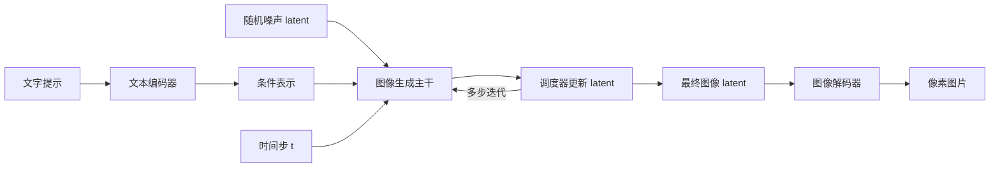
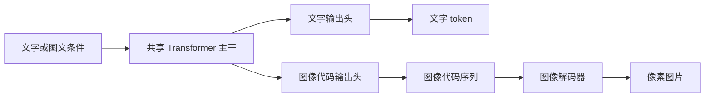

# 多模态主干、视觉理解与图像生成

本笔记整理“图文是否只共享一个主干”“生成图片时模块如何连接”“两种模态是否只在 embedding 上不同”。这里讨论通用机制与几种已公开架构；没有在本项目中执行图像生成实验。整体阅读顺序见 [模型知识导读](model-knowledge-guide.md)，固定模型的组成、任务路径与转换集中见 [Qwen3.5-4B 专题](qwen35-components-and-weight-conversion.md)。

## 1. 先明确说的是哪一个主干

“主干”指承担主要表征处理的核心网络，不表示整个系统只剩一个神经网络。一个完整多模态模型可以同时有视觉编码主干、共享的语言/多模态主干，以及输入映射和输出解码网络。

例如，视觉编码网络和特征合并组件可以接到一套共享语言主干上。因此，共享语言主干只有一套，完整模型仍包含多个有参数的计算组件。Qwen 的具体层数和连接见上述专题。

“共享”说的是使用相同的一套参数；并非先用一个文本模型生成文字答案，再用另一个模型理解图片，最后合并两份答案。视觉编码输出向量，语言主干结合问题与向量生成回答。不同系统可能采用跨注意力、独立分支等结构，不能把这一连接方式推广成所有多模态模型的唯一形式。

### 为什么组件可以不接入：结构、权重与执行路径

模型代码定义有哪些算子、模块和连接关系，权重文件保存这些模块需要的具名张量，配置描述尺寸与行为。safetensors 可以按名称读取张量；但能筛出一批张量，不代表这些参数一定组成可独立运行的模型。[safetensors 文档](https://huggingface.co/docs/safetensors/index)

能否省略一个组件，取决于保留任务的计算图是否仍然完整。例如普通文本生成的链路是 embedding → 语言层 → 最终归一化/词表投影；没有图片输入时，这条链路不需要视觉编码输出。标准逐 token 主路径也不要求启用 MTP 辅助分支。开发者可以只构造语言模型，再加载其所需张量，而不构造视觉或 MTP 模块。

这里应区分三件事：不调用模块，只减少本次计算，模块权重仍可能已加载；不构造/不加载模块，才使运行模型不持有这些参数；删除磁盘文件则改变来源或产物保留，属于另一件事。本项目保留完整官方源于磁盘，另生成语言执行产物；C++ 固定语言结构只接受后者所需的张量，并未构造视觉或 MTP 网络。

这种可选性来自已设计和验证的任务路径，并非任意网络层都可自由拆卸。32 层语言主干中的某层被去掉，即使残差接口恰好让 shape 仍能连接，计算函数也已经改变，不能认为等价。省略视觉/MTP 分支同样没有撤销这些分支曾在训练期间对语言主干产生的影响；它只改变当前保留和执行的子图。

## 2. 图像生成可以有独立的生成主干

以潜空间扩散为例，文本编码器先给提示词生成条件表示；图像生成网络从随机噪声开始，多次预测并更新图像 latent，最终由图像解码器还原像素。生成主干可以是 UNet 或 DiT，文本编码器不必是一个能聊天的完整 LLM。[Diffusers 组件说明](https://huggingface.co/docs/diffusers/en/quicktour)



这里的 latent 是图像的压缩表示，不是提示词向量，也不是完整 RGB 图片。以 VAE 为例，训练时用编码器将真实图片映射到 latent，解码器学习重建；文生图推理中，生成网络产出 latent 后才经解码器生成图片。[Latent Diffusion 原论文](https://arxiv.org/abs/2112.10752)

多次迭代通常复用同一生成网络的参数，变化的是当前 latent 与时间步，不是每一步都换一个模型。调度器规定如何根据预测结果更新状态，通常是算法组件而非另一个大型学习网络。如果聊天助手调用外部图像生成器，助手的语言主干和该图像生成主干也是两套参数，并不因统一在同一个界面就自动共享。

## 3. 也可以共享主干，分别输出文字与图像代码

另一类架构将图片通过图像 tokenizer/codec 表示成离散代码。共享 Transformer 在文字任务中预测文字 token，在图像任务中预测图像代码；图像代码随后由专门解码器还原成像素。Janus 展示了共享自回归主干与分离视觉编码路径的方案；其代码使用图像生成 head 预测代码，再调用视觉生成解码器。[Janus 论文](https://arxiv.org/abs/2410.13848)、[官方实现](https://github.com/deepseek-ai/Janus)



这是独立输出头的一种结构示意，不能据此认定所有统一模型都采用同一词表或同一 head。图像代码也不是把图片翻译成自然语言句子；它代表图像 codec 的离散状态，服务于重建纹理、布局等内容。

Janus 还提示一个重要区分：理解图片的视觉表示与重建图片的视觉表示不一定相同。前者追求任务相关语义，后者需要保留可重建的细节；同一共享主干可以配不同的视觉输入/输出接口。视觉理解编码器没有天然可用的反向“画图”功能。

## 4. 共享主干也不要求图片离散化

Transfusion 给出另一种方案：用同一个 Transformer 处理离散文字与连续图像表示，文字使用下一 token 预测，图片使用扩散目标，并配模态专用输入/输出层。它在文字部分使用因果注意力，在每张图片内部允许 patch 之间双向交互。[Transfusion 原论文](https://arxiv.org/html/2408.11039v1)

所以，“共享主干”“输出是离散还是连续”“生成过程是自回归还是迭代去噪”是不同的设计维度。不能从共享一个 Transformer 就推断所有模态必须采用同一种生成算法。

## 5. 两种模态的差别贯穿整条链路

| 维度 | 文字中的常见形式 | 图片中的常见形式 |
| --- | --- | --- |
| 原始输入 | 字符、字节组成的文本 | 二维像素网格，视频还带时间轴 |
| 编码 | tokenizer 得到离散 ID，再查 embedding | 视觉编码器特征，或图像 codec 的连续 latent / 离散代码 |
| 拓扑与位置 | 一维 token 顺序 | 二维空间；展平后仍需保留位置关系，视频还需时间关系 |
| 需要保留的信息 | 词法、语义、指代、顺序等 | 理解侧关注任务相关内容；生成侧还需可重建的形状、纹理、颜色与布局 |
| 交互规则 | 自回归语言输出通常使用因果约束 | 视觉编码器可进行全图交互；去噪常允许图内双向交互；进入语言主干后的规则仍由架构决定 |
| 输出头 | 词表上的 logits | 图像代码 logits，或连续噪声/速度等预测 |
| 输出还原 | token ID 经 tokenizer 解码为文本 | 图像代码/latent 经图像解码器成为像素，或采用直接像素生成架构 |
| 推理状态 | 自回归前缀可缓存 KV 或递推状态 | 去噪中各位置状态会随迭代更新，不能原样套用文本前缀缓存逻辑 |

两类输入可以都被投影为 `[..., D]` 的向量，但 D 相同只说明接口尺寸兼容，不能说明语义、位置、信息保留程度或输出规则相同。正确的匹配还依赖训练与整个计算图。

这里“token”有时表示序列中的一个向量，有时特指词表/码本中的离散 ID。视觉编码器输出被称为 visual tokens，并不意味着模型已具备预测图像代码并解码成图片的能力。

## 6. 训练目标为何也不同

典型自回归文本生成学习的是在已知前缀下，给正确下一 token 更高概率，常用交叉熵：

```text
L_text = -log p(正确的下一 token | 前缀)
```

离散图像代码的自回归生成也可采用这类分类目标，只是候选码本与输出含义不同。以 DDPM 的一种常见参数化为例，模型看到真实样本加噪后的状态和时间步，学习预测所加噪声，使用回归损失：

```text
z_t = alpha_t × z_0 + sigma_t × epsilon
L_diffusion = ||epsilon - model(z_t, t, 条件)||²
```

这只是典型形式；还存在其他预测参数化和 flow matching 等目标，不能把所有图片生成统称为预测噪声。[DDPM 原论文](https://arxiv.org/abs/2006.11239)

一个图像问答模型即使会对图片生成正确文字，训练目标也未必要求它重建图片。要产生图片，仍需要相应的输出表示、生成头/生成网络、图像解码器及训练目标。把视觉编码器“倒过来接”不会自动补齐这些能力。

## 复习问题

- “只有一个共享语言主干”为什么不等于整个系统只有一个神经网络？
- 文本编码器在潜空间扩散中做什么？每个时间步变化的是参数还是状态？
- visual token、离散图像代码、连续图像 latent 分别是什么？
- 共享 Transformer 为什么仍可能需要不同的注意力规则、输出头和损失？
- 为何同样的向量维度不能证明两种表示可以互换？
- 会图像问答的模型还缺哪些部分，才可能具备图像生成能力？
