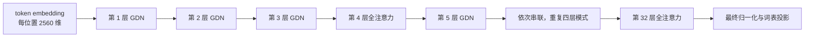
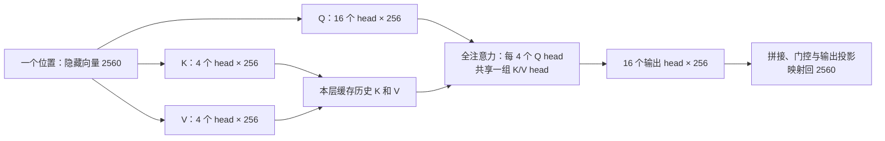
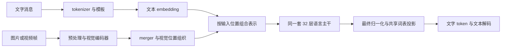

# Qwen3.5-4B 专题：组件、任务路径与权重转换

本页集中解释本轮针对 Qwen 的问题。范围限定为 `Qwen/Qwen3.5-4B`、revision `851bf6e806efd8d0a36b00ddf55e13ccb7b8cd0a`，不能把这里的层数、参数命名或转换规则推广到整个 Qwen 家族。结构依据为 [固定官方配置](https://huggingface.co/Qwen/Qwen3.5-4B/blob/851bf6e806efd8d0a36b00ddf55e13ccb7b8cd0a/config.json)、原始权重索引和固定版本的加载实现。

通用多模态机制见 [多模态笔记](multimodal-backbones-and-image-generation.md)，训练机制见 [SFT/LoRA 笔记](sft-lora-and-weight-updates.md)；本页用具体模型串联它们。

## 1. 一个完整模型为什么会有多个组件

完整权重包含语言网络、视觉编码与合并组件，以及 MTP 辅助分支。它们有可区分的参数，却不是两个或三个各自独立回答问题的聊天模型。

| 组件 | 具体结构与作用 | 与其他部分的关系 |
| --- | --- | --- |
| tokenizer、词表和聊天模板 | 把消息组织成文本 token IDs；输出 IDs 再解码成文字 | 这些是输入输出规则，不是另一个神经网络 |
| 文本 embedding | 将词表 ID 映射为 2560 维向量 | 供语言主干处理；其矩阵也用于最终词表投影，即 tied embeddings |
| 语言主干 | 32 层：`[GDN, GDN, GDN, 全注意力] × 8`，每层还有归一化、MLP、残差 | 共 24 个递推层、8 个全注意力层；图文理解中的融合推理使用这同一套语言参数 |
| 视觉组件 | patch embedding、24 个视觉编码块、merger；视觉内部 hidden size 为 1024，输出映射到 2560 | 把图片/视频内容变为语言侧可接收的视觉表示，不直接输出自然语言答案 |
| 最终归一化与词表投影 | 把语言 hidden states 转为词表 logits | 共享输入 embedding 权重不表示免去输出投影计算 |
| MTP 辅助分支 | 多 token 预测相关的额外参数；固定配置声明一个 MTP hidden layer | 配合特定训练/解码方案使用，不是普通逐 token 生成必须经过的主干层 |

“一个共享语言主干”并不表示全系统只有一个有参数的网络：视觉侧也有自己的编码主干。视觉表示已被训练为与语言侧接口匹配；2560 维相同只是连接所需条件之一，不能把任意同维向量塞入后期待正确理解。

GDN 层通过卷积历史和递推状态保留上下文；全注意力层读取历史 keys/values。于是同一个文本请求同时需要不同类型的状态，而不是所有层都只维护 KV cache。更详细的数据流和状态观察见 [数值对照](fixed-model-numerical-validation.md#2-从模型结构推导要观察哪些状态)。

### 语言层、head 与维度怎样连接

32 层是一个串联序列，24 个 GDN 层和 8 个全注意力层交错排列，不是两条并行主干。以下层号从 1 开始，每层都有自己的参数和状态：



每层先做归一化、对应的混合模块和残差，再做归一化、MLP 和残差。层与层之间每个位置的 hidden size 为 2560；MLP 的中间维度为 9216，再映射回 2560。不同层是串联；head 是特定混合模块内的并行计算分组，并不是整个层，也不是单独一个向量。

在普通多头注意力中，一个位置的隐藏向量经投影得到多组 Q、K、V；每个 head 用对应 Q 和历史 K 计算权重、加权读取 V，得到一个输出向量；各 head 输出拼接后再投影。不同 head 可学习不同表示和读取方式，但不能预先断言每个 head 有特定人类语义。每个 token 不必全模型只有一个 V：普通多头情况下每个 head 有一个 V；实际模型可共享 KV。



图省略 Q 的归一化、RoPE 等细节；当前实现的 Q 投影还生成输出 gate。head 数是组数，head dimension 是每组向量长度；投影可改变总宽度，因此 `16 × 256` 不必等于 hidden size。GDN 的 Q/K 是 `16 × 128`、V 是 `32 × 128`；其 key dimension 和 value dimension 恰好都是 128，但含义分别是每个 Q/K 和 V 的向量长度。Q/K 头扩展以匹配 value 头，递推状态形状为 `[batch, 32, 128, 128]`；这不是把全注意力的计算套在 GDN 上。具体张量与状态见 [数值对照](fixed-model-numerical-validation.md#2-从模型结构推导要观察哪些状态)。

### KV cache 仍然使用 K 和 V，为什么通常不缓存 Q

因果增量推理中，处理 A、B 后，本层缓存 `[kA, kB]` 和 `[vA, vB]`。处理 C 时计算新 `qC、kC、vC`，将新 K/V 加入缓存，用 `qC` 与 `kA、kB、kC` 计算权重，再读取 `vA、vB、vC`；下一步 D 同理。缓存避免对旧位置重复计算 K/V，注意力仍要读取它们，缓存也会随上下文增长。

旧的 `qA、qB` 已用于计算它们各自位置的输出。因果生成中旧位置不关注未来位置，追加 C 不需要重新计算 A、B 的注意力输出；D 需要的是新算的 `qD`。因此普通增量解码不需要保存旧 Q，并非 Q 在技术上无法缓存：若另一个算法要重算旧输出、做诊断或处理非因果注意力，是否缓存取决于其计算需求。缓存成立依赖模型权重和已处理前缀等条件不变；改变它们需重新计算受影响状态。

## 2. 不同目的会用到哪些组件



图中是任务连接示意；视频还涉及帧采样、时间维度与位置组织，不能把图像简单改名为视频就算完成处理。

| 使用目的 | 参与路径 | 不能由此推断什么 |
| --- | --- | --- |
| 纯文本问答、抽取、生成 | 模板/tokenizer → embedding → 语言主干 → 词表投影 → 解码 | 不要求视觉输入，也不要求 MTP 分支参与 |
| 图片问答、OCR、视频理解 | 视觉预处理/编码/合并，与文字表示组合，再经语言主干输出文字 | 有视觉权重不等于预处理、位置编码和运行接口已经接好 |
| 纯文本 SFT/LoRA | 文本路径，加监督 loss、反向传播与优化器更新 | 不因只训练 adapter 就省去基础模型计算；是否冻结哪些模块由训练方案决定 |
| MTP 相关训练或解码 | 语言主路径配合辅助分支和专门算法 | 权重文件里有 MTP 不代表运行器已启用，更不证明已有加速收益 |
| 原生像素图像生成 | 这个固定模型未提供相应生成头/生成网络和图像解码路径 | 会读图不说明会画图；通用图像生成架构见多模态笔记 |

## 3. 为什么能精确选出 text 部分，还能不加载视觉/MTP

权重是带名称、shape、dtype 的张量集合，模型代码定义这些张量的用途，配置定义尺寸和连接。原始索引中的 `model.language_model.*`、`model.visual.*`、`mtp.*` 给出模块归属；两个 safetensors 文件只是存储分片，两片都可能包含语言参数，不能按文件把一片叫语言模型、另一片叫视觉模型。

纯文本前向从 embedding 到词表输出形成完整路径，不消费视觉编码输出，也不必经过 MTP 分支。因此可只构造语言网络，收集两片文件中属于它的张量，再核对名称、形状、dtype 和集合完整性。名称筛选提供参数边界，代码及数值验证确认保留路径确实可运行。

这不适用于任意删层：移除语言主干中的一层，即使 shape 仍能接起来，函数也改变了。省略视觉分支也没有撤销多模态训练曾对共享语言权重产生的影响；它只使本次执行不再读取视觉输入。

要区分“不调用”“不加载”和“从磁盘删除”：不调用可能仍让权重占内存；不构造、不加载才能避免该分支持有运行参数；磁盘保留完整官方源则是材料管理，源文件存在不表示视觉组件驻留 GPU。

## 4. 本项目下载和使用的是哪些部分

以下是 2026-10-27 这次案例中的目录与材料，不作为长期路径或当前状态的第二份规范；操作入口统一见 [正式短验证文档](../../docs/model-validation.md)。

| 材料 | 本次位置 | 内容与作用 |
| --- | --- | --- |
| 官方源 | `runs/models/qwen35-4b-official/` | 完整两片原始权重：语言 426、视觉 297、MTP 15 个张量；约 8.7 GiB，作为转换输入 |
| 活动语言制品 | `runs/models/qwen35-4b-text-4bit/` | 语言参数经适配及 affine 4-bit/group-64 量化，含 tokenizer 等约 2.23 GiB；正式 C++ 读取该制品 |
| 复现副本 | `runs/models/qwen35-4b-text-4bit-repro/` | 从同一官方源重新转换，另带逐参数审计和转换器身份，供比较，不自动替代活动制品 |

源目录同时包含 tokenizer、词表、聊天模板、配置和许可证，但没有下载远端仓库所有附属文件，例如图像/视频预处理配置。因此“完整原始权重已下载”与“完整多模态使用环境已准备好”是两种判断。本次没有下载 9B 权重。

## 5. 名称、布局与数值表示为什么改变

这条链路是：

```text
Qwen 官方源权重
  → 选取语言参数
  → MLX-LM 命名、布局和归一化约定适配
  → MLX affine 4-bit/group-64 量化
  → 语言执行制品
```

模型参数来源是 Qwen；适配规则主要来自 [MLX-LM 0.32.2 的 Qwen3.5 sanitizer](https://github.com/ml-explore/mlx-lm/blob/v0.32.2/mlx_lm/models/qwen3_5.py)，加载、量化和保存沿用 [上游 utils](https://github.com/ml-explore/mlx-lm/blob/v0.32.2/mlx_lm/utils.py)。它们不是 Qwen 原始权重文件，也不是项目手工猜测出来的修改。项目负责固定来源、资源预检、语言制品范围、文件复制、清单和审计。

### 名称映射是模块路径适配

例如 `model.language_model.layers.0...` 变为 `language_model.model.layers.0...`。名称告诉加载器把张量放到哪个模块；改前缀本身不改变矩阵数值。名称一致仍不保证语义一致，后续必须核对布局与算子约定。

### 转轴保留元素，却改变算子读取的维度含义

24 个卷积权重从 `[8192, 1, 4]` 转为 `[8192, 4, 1]`，通过移动轴 2 到轴 1 完成，适配 MLX 卷积要求。不能只修改 shape 元数据来假装完成任意转置；必须遵照元素与维度的实际映射。在这个特定例子中，有一个维度为 1，但规则依据仍是源/目标算子的轴约定。

### 特定 RMSNorm 加一是在保持计算语义

源侧某些归一化参数使用偏移表示，示意为：

```text
源计算：y = normalize(x) × (1 + w_source)
目标计算：y = normalize(x) × w_target
所需映射：w_target = 1 + w_source
```

所以数值发生变化，却是在适配同一个期望计算，不是通过训练增加新知识。上游在识别原始卷积布局后，对指定的 81 个一维归一化权重执行加一，不是给所有带 norm 名称的参数加一。已转换权重不能再无条件套一次，否则相当于额外偏移。

### 量化是有损表示变换

本例把 249 个矩阵各转成 packed weight、scales、biases。uint32 可打包 8 个 4-bit 编码，每 64 个输入方向元素共享一组缩放和偏置；还原可示意为 `近似权重 = scale × 编码 + bias`，精确规则由 MLX 格式决定。因此：

```text
输出张量数 = 原语言张量 426 + 249 × 2 = 924
```

张量数量增加不表示模型多了层。最终 2.23 GiB 也不是单靠删除视觉组件获得的：原始语言张量仍约 7.83 GiB，主要压缩来自量化。量化会引入近似，没有使用样本、loss 和梯度训练；SFT/LoRA 才按训练目标更新被选参数，两者不能混称。

## 6. 怎样让转换过程可审查、可复现

只写“用了某版本库”不足以让人看懂具体变化。应同时保存输入身份、转换规则、实际代码身份、逐参数变化和输出摘要，并在新目录重跑比较；大权重本身不必进 Git。

本案例的 [规则文件](../../tools/model_artifacts/qwen35/qwen35_conversion_rules.json)、[准备脚本](../../tools/model_artifacts/qwen35/prepare_qwen35.py)、[审计代码](../../tools/model_artifacts/qwen35/qwen35_conversion.py) 和 [复现比较器](../../tools/model_artifacts/qwen35/verify_qwen35_reproduction.py) 把这些信息显式化。实际变换仍调用已知正常的上游主路径，审计核对结果，而不是另写一套转换偷偷取代它。

2026-10-27 已从同一官方源完整重跑，权重、索引、配置及附属材料共 9 个文件与原制品逐字节一致；新生成的规则副本、转换器身份和审计文件本应不同，artifact 清单也随之不同。源文件转换前后的 SHA-256 保持一致。该观察支持“这份脚本在固定环境复现了原制品”，不证明量化与 BF16 完全等价，也不承诺其他硬件或版本仍逐字节一致。

当前 C++ 与独立参考比较的是同一量化制品，主要验证执行实现；评价量化损失还需要原始 BF16 对照及独立任务效果。前向一致也不能替代目标训练梯度和恢复验证。操作命令、当前证据和验收边界仍分别由正式文档与快照维护。

## 复习问题

- 为什么两片 safetensors 不能解释为两个独立模型？
- 不加载视觉组件为什么不等于把多模态训练影响从语言参数中移除？
- rename、转轴、归一化加一、量化分别在改变什么，哪一步明确属于有损近似？
- 426 个语言张量变成 924 个，为什么模型没有增加层？
- 九个文件复现一致与量化效果无损，是哪两种不同的结论？
